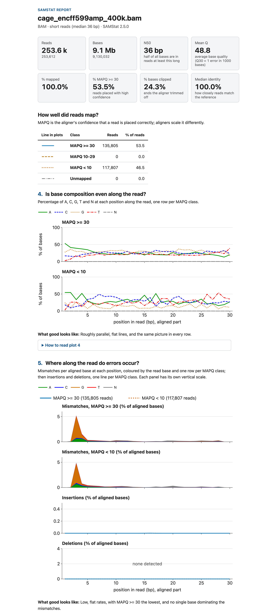

[[https://github.com/TimoLassmann/samstat/actions/workflows/cmake.yml][https://github.com/TimoLassmann/samstat/actions/workflows/cmake.yml/badge.svg]]
[[https://github.com/TimoLassmann/samstat/releases/latest][https://img.shields.io/github/v/release/TimoLassmann/samstat.svg]]
[[file:COPYING][https://img.shields.io/badge/license-MIT-blue.svg]]
[[https://doi.org/10.1093/bioinformatics/btad019][https://img.shields.io/badge/DOI-10.1093%2Fbioinformatics%2Fbtad019-blue.svg]]
* SAMStat

SAMStat is an efficient C program to quickly display statistics of large
sequence files from next generation sequencing projects. When applied to SAM/BAM
files all statistics are reported for unmapped, poorly and accurately mapped
reads separately. This allows for identification of a variety of problems, such
as remaining linker and adaptor sequences, causing poor mapping. Apart from this
SAMStat can be used to verify individual processing steps in large analysis
pipelines.

SAMStat reports length distribution, base quality distribution, mapping
statistics, mismatch, insertion and deletion error profiles. The output is a
single html page:

Part of the report for 400,000 records of an ENCODE CAGE run (ENCFF599AMP, 36 bp). Plot 5 shows the extra G that the cap-trapping protocol adds at the 5′ end of CAGE reads, as mismatches at the start of the read in both MAPQ classes.

* How to install

*SAMstat* needs autoconf/automake and the zlib, bzip2 and xz (lzma) headers to build the bundled htslib; bzip2 and xz are needed for CRAM. To install on linux:

Ubuntu/Debian:

#+begin_src bash :eval never
sudo apt-get install -y autoconf automake zlib1g-dev libbz2-dev liblzma-dev
#+end_src

On a mac via [[https://brew.sh][brew]]:

#+begin_src bash :eval never
brew install autoconf automake xz
#+end_src

To build *SAMstat*:

#+begin_src bash :eval never
git clone https://github.com/TimoLassmann/samstat.git
cd samstat
cmake -S . -B build
cmake --build build -j4
(cd build && ctest --output-on-failure)
cmake --install build
#+end_src

Optional CMake options: =-DSAMSTAT_USE_SYSTEM_HTSLIB=ON= (use the system htslib instead of the bundled one; use htslib 1.22 or newer, see "Network access" below), =-DSAMSTAT_SANITIZE=ON= (AddressSanitizer and UBSan) and =-DSAMSTAT_REQUIRE_MULTIQC=ON= (fail to configure if =multiqc= is missing, so the MultiQC integration test always runs).

Some memory errors only show up in a sanitizer build, so before a release also run the whole suite with it:

#+begin_src bash :eval never
cmake -S . -B build-asan -DCMAKE_BUILD_TYPE=Debug -DSAMSTAT_SANITIZE=ON
cmake --build build-asan -j4 && (cd build-asan && ctest --output-on-failure -j4)
#+end_src

* Usage

#+begin_src bash :eval never 
samstat [options] <file|-> [file ...]
#+end_src

Input type (SAM, BAM, CRAM, FASTA or FASTQ, plain or gzip) is detected from the content. CRAM needs its reference: SAMStat finds it through the =REF_PATH= and =REF_CACHE= environment variables; if the reference is not found that file fails with a message naming both variables. A file name of =-= reads standard input; its reports are named =stdin.samstat.*=. Protein FASTA is not supported. For each input file SAMStat will create a single html page named after the input file name plus a dot =samstat.html= suffix.

Exit codes:
- 0: success, also for inputs without reads (with a warning);
- 1: at least one input failed, for example an unrecognised input or a report that could not be written (the other inputs are still processed and reported);
- 2: usage error (bad option or value, nothing is read).

Diagnostics (log lines with =--verbose=, warnings, errors, the one-line summary per input and the progress counter) go to standard error; the reports are files, so standard output stays free. The progress counter is shown only when standard error is a terminal and only one input is processed at a time.

Network access: with the bundled htslib (built without libcurl and S3 support) SAMStat never uses the network. A system htslib built with libcurl opens inputs given as URLs over the network, and htslib before 1.22 also downloads a CRAM reference from the EBI server when =REF_PATH= is not set; with a system htslib, use 1.22 or newer and set =REF_PATH= to keep SAMStat offline.

Threads: the output is identical for any =-t=. =-t= is the number of threads SAMStat itself uses (the reader of an input, its decompression thread pool and the workers). With at least as many inputs as threads, each input runs on its own thread; with fewer, the inputs run one after another and the threads are shared within each input. When a decompression pool is in use (=-t 3= or more on fewer inputs than threads), htslib may add one or two input/output threads of its own (the BGZF reader, the SAM text parser), so the process can show up to =-t= + 2 threads.

Memory: for files of sequencing reads, memory is bounded by the number of threads and the batch limits, not by the size of the input: a batch holds at most 4096 records and stops once it has about 8 million bases, and an input has at most two more batches in flight than it has workers. A record longer than 50 Mb is not a read and fails the input. FASTA and FASTQ inputs are also checked in their first 64 MiB before reading starts.

=-p N= stops after the first N primary reads (records that are not secondary or supplementary). To decide whether the report is partial SAMStat then looks for one more primary read: when only secondary and supplementary records follow the cutoff, it reads on through them, up to the end of the file, without counting them.

Available options:

#+begin_src bash :eval never 
  -d, --dir DIR      write reports to DIR (created if missing) [next to input]
  -p, --peek N       analyse only the first N reads (not random) [all]
  -t, --threads N    total threads, 1-64, at most the number of CPUs [4]
      --json         also write <input>.samstat.json
      --multiqc      also write MultiQC files <input>.samstat_*_mqc.json
      --verbose      debug output
  -h, --help / -v, --version
#+end_src

The JSON format is described in =docs/json-format.md=, the MultiQC files in =docs/multiqc.md=. =--nthreads= is accepted as an alias of =--threads=. The options =-l=, =--seed=, =--norm= and =--plotend= are deprecated: they are still accepted, print a warning and are ignored.

Before reading any input SAMStat checks that every report can be written. If a report directory is not writable that input fails (exit code 1) and the message suggests =-d DIR=. Two inputs that would write the same report file are a usage error (exit code 2).

* The report

The report is one self-contained HTML page: no JavaScript, no network request, and it prints to A4. It has a header line, a summary strip (reads, bases, N50, mean Q and, for aligned input, % mapped, % MAPQ >= 30, % bases clipped and median identity), a few factual notes where they apply, and, for aligned input, a table of the four MAPQ classes that is also the key for every coloured line. Then come six plots in a fixed order, each with a question as title, a one-sentence caption, a visible "What good looks like:" line and a collapsed "How to read plot N":

1. How long are the reads? Read length distribution with N50.
2. How good is each read? Distribution of per-read mean base quality.
3. Where along the read does quality drop? Mean quality by position.
4. Is base composition even along the read? A, C, G, T and N by position, one row per mapping-quality class (aligned input) or one row of all reads (unaligned input).
5. Where along the read do errors occur? Mismatch rates by position, one row per mapping-quality class and stacked by the read base (A, C, G, T, N); then insertion and deletion rates by position (aligned input only).
6. How accurate are the aligned reads? Distribution of per-read identity (aligned input only).

Lines are coloured by mapping-quality class; paired input shows Read 1 and Read 2 side by side. Positions are in base pairs for short reads and in percent of read length when the median length is 1 kb or more. Unaligned input (FASTQ, FASTA, unaligned BAM) shows plots 1 to 4 only. Plots 3 to 5 (the per-position plots) are replaced by a one-line note when the input has fewer than 50 reads. A plot that cannot be drawn, for example mismatches for a BAM without MD tags, is replaced by a one-line note. bwa-mem and bwa-mem2 write MD tags by default; STAR and minimap2 (without =--MD=) do not.

* New in 2.5.0

- Base composition (plot 4) and mismatches (plot 5) are shown per mapping-quality class again, with the mismatches stacked by read base (A, C, G, T, N), as in both SAMStat papers.
- A, C, G, T and N use the IGV colours.
- The JSON output gains an optional key =mismatch_base=; =format_version= stays 2.

* New in 2.4.0

- Intra-file threading: =-t= is the total thread budget and speeds up a single input.
- The HTML report is rebuilt with six fixed plots as inline SVG, and works offline.
- JSON format version 2 (breaking), a reworked MultiQC output, standard input, and content-based input detection.
- CRAM input (the reference is found through =REF_PATH= or =REF_CACHE=; no network access with the bundled htslib).
- Protein FASTA is unsupported; =-l=, =--seed=, =--norm= and =--plotend= are ignored.

See =CHANGELOG.md= for the full list of changes and breaking changes.

* New in 2.3.0

- =--json= : machine-readable summary of the statistics (for pipelines and downstream tools).
- MultiQC support: SAMStat output can be aggregated by [[https://multiqc.info][MultiQC]] (see =docs/multiqc.md=, option =--multiqc=).

See =CHANGELOG.md= for details.

* Please cite:
Timo Lassmann (2023) "SAMStat 2: quality control for next generation sequencing data." Bioinformatics. (2023): btad019, https://doi.org/10.1093/bioinformatics/btad019

Lassmann et al. (2010) "SAMStat: monitoring biases in next generation sequencing data." Bioinformatics 27.1 (2011): 130-131. [[https://doi.org/10.1093%2Fbioinformatics%2Fbtq614][doi:10.1093/bioinformatics/btq614]]

